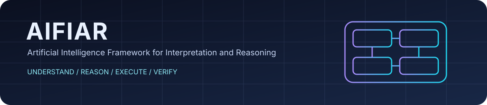
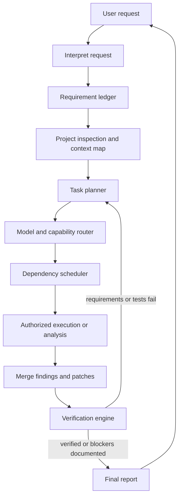

<div align="center">
  
  <h1>AIFIAR</h1>
  <p><strong>Artificial Intelligence Framework for Interpretation and Reasoning</strong></p>
  <p><em>Understand. Reason. Execute. Verify.</em></p>
  <p>
    
    
    
    
  </p>
</div>

<p align="center">
  
</p>

> **Project status:** AIFIAR is an early-stage architecture and TypeScript scaffold. The core modules define interfaces and initial workflow logic. Provider adapters, tool integrations, sandboxed execution, persistent memory, and end-to-end verification are not yet fully implemented. Documentation describes intended behavior, not a claim that every feature is already operational.

## What is AIFIAR?

AIFIAR is designed to help AI tools work on software projects in a disciplined, provider-aware way. It aims to interpret a user's request, preserve all requirements, inspect the project before editing, select suitable models for independent tasks, coordinate execution, protect sensitive files, and verify the final result.

AIFIAR is **not** intended to shorten prompts by silently deleting details. It tracks requirements explicitly and sends each task the context needed to complete it.

## Design principles

- **Requirements are preserved:** every explicit requirement should be tracked to a result or an openly reported blocker.
- **Inspect before editing:** map the repository and understand relevant files first.
- **Small, scoped changes:** prefer targeted patches over unnecessary rewrites.
- **Provider-neutral core:** model-specific behavior belongs behind adapters and provider folders.
- **Parallel only when safe:** independent analysis can run concurrently; dependent tasks wait for their prerequisites.
- **Verify, do not guess:** distinguish evidence from assumptions and run available checks.
- **Human control:** protected paths and consequential actions require explicit authorization.
- **Budget awareness:** track token and cost estimates where provider usage data is available; never promise that multiple models cost the same as one.
- **Readable approvals:** summarize planned changes at Beginner, Intermediate, or Expert detail levels.

## Architecture at a glance



See [the architecture guide](docs/architecture.md) and [the workflow guide](docs/workflow.md).

## Repository map

| Path | Responsibility |
|---|---|
| `core/` | Single-purpose planning, evidence, context, routing, retry, memory, source assessment, and verification modules |
| `models/registry.ts` | Provider/model capability declarations |
| `models/gpt/` | GPT-specific operating guidance and adapter contract |
| `models/grok/` | Grok-specific operating guidance and adapter contract |
| `docs/` | Architecture, safety, routing, memory, budgets, and roadmap |
| `assets/` | SVG logo, banner, and `favicon.svg` for project/site branding |
| `examples/` | Example model registry and project policy |
| `AGENTS.md` | Repository-wide instructions for coding agents |

## Model support

AIFIAR separates **instructions** from **actual integration**. Instructions can guide a coding agent that reads this repository, but they do not automatically connect a model to an API or give it filesystem access.

| Provider/tool family | Initial status |
|---|---|
| GPT | Instructions and adapter contract scaffold |
| Grok | Instructions and adapter contract scaffold |
| Claude | Reserved provider directory planned |
| Gemini | Reserved provider directory planned |
| GitHub Copilot | Tool-specific integration to be evaluated |
| Codex | Tool-specific integration to be evaluated |

Availability, tool access, model names, rate limits, and capabilities depend on the actual provider and execution environment. See [provider integration](docs/provider-integration.md).

## Quick start

Requirements: Node.js 20 or newer.

```bash
npm install
npm run typecheck
npm run build
```

These commands type-check, build, and run the current core helper tests. They do not connect to an AI provider or run arbitrary project code.

No API key is required for the scaffold. When a real provider adapter is implemented, credentials should be supplied through environment variables or a secure secret manager, never committed to the repository.

## Intended task lifecycle

1. **Interpret:** identify the goal, constraints, expected deliverables, and ambiguity.
2. **Record:** create a requirement ledger without dropping details.
3. **Inspect:** map the project and read relevant documentation and code.
4. **Plan:** divide work into explicit tasks and dependencies.
5. **Route:** choose models based on declared capabilities, availability, budget, and evaluations.
6. **Approve:** show a readable plan and request permission for protected or high-impact actions.
7. **Execute:** perform scoped work in isolated workspaces where possible.
8. **Integrate:** reconcile findings and patches; resolve conflicts rather than blindly choosing a majority.
9. **Verify:** run checks and map results back to requirements.
10. **Report:** state what changed, what passed, what remains, and what was not tested.

## Documentation

- [Architecture](docs/architecture.md)
- [AI operating rules](docs/ai-operating-rules.md)
- [AI agent checklist](docs/ai-agent-checklist.md)
- [Reasoning and evidence](docs/reasoning-and-evidence.md)\n- [AI agent checklist](docs/ai-agent-checklist.md)
- [End-to-end workflow](docs/workflow.md)
- [Requirement preservation](docs/requirements.md)
- [Task routing and parallel scheduling](docs/routing-and-parallelism.md)
- [Project memory and repository mapping](docs/project-memory.md)
- [Token and cost management](docs/token-management.md)
- [Permissions and protected files](docs/permissions-and-safety.md)
- [Patch integration and verification](docs/verification.md)
- [Provider integration](docs/provider-integration.md)
- [Paste-a-repository-link workflow](docs/repository-link-workflow.md)
- [GPT instructions](models/gpt/INSTRUCTIONS.md)
- [Grok instructions](models/grok/INSTRUCTIONS.md)
- [Provider instruction template](models/PROVIDER_TEMPLATE.md)
- [Roadmap](docs/roadmap.md)

## Roadmap

- [x] Initial architecture and repository guidance
- [x] Strict TypeScript scaffold with separated core modules
- [x] GPT and Grok instruction sets
- [x] Mermaid architecture documentation
- [ ] Implement provider adapters against documented, available interfaces
- [ ] Add durable project-index storage with freshness checks
- [ ] Add isolated patch workspaces and safe patch application
- [ ] Add sandboxed command execution and permission gates
- [x] Add initial unit tests for core helpers, plan validation, source ranking, and AI rule enforcement\n- [ ] Expand unit coverage and add end-to-end integration tests
- [ ] Add measured token/cost telemetry and provider-specific limits
- [ ] Evaluate routing quality and verification reliability

## Contributing

Please read [CONTRIBUTING.md](CONTRIBUTING.md) and [AGENTS.md](AGENTS.md) before proposing changes. Do not submit secrets, real credentials, or untrusted executable payloads.

## License

AIFIAR is distributed under the MIT License. See [LICENSE](LICENSE).

---

<div align="center">
  <sub>Built for careful, traceable, model-aware AI-assisted engineering.</sub>
</div>
