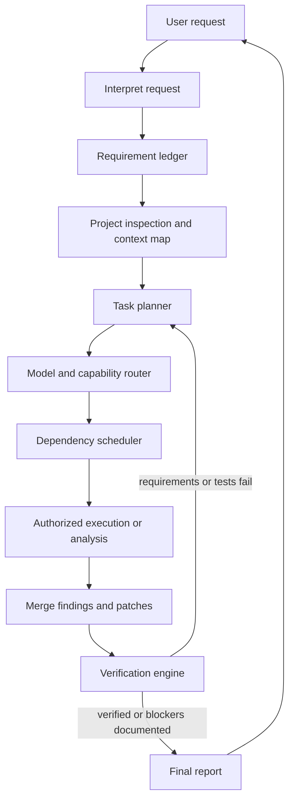

<div align="center">
  
  <h1>AIFIAR</h1>
  <p><strong>Artificial Intelligence Framework for Interpretation and Reasoning</strong></p>
  <p><em>Understand. Reason. Execute. Verify.</em></p>
  <p>
    
    
    
    
  </p>
</div>

<p align="center">
  
</p>

> **Project status:** AIFIAR is an early-stage framework with tested TypeScript workflow modules, Python safety tooling, an optional Docker runner, OpenAI Chat Completions and Responses adapters, and an xAI Chat Completions adapter. It includes durable repository memory, task-scoped source context, strict digest-bound patch proposals, a host approval boundary, a hash-chained transaction journal, and POSIX directory-descriptor-based patch operations. It is not yet a complete autonomous coding agent. A local Node recovery adapter is available for trusted workspaces, but it does not eliminate hostile-process filesystem races. Authenticated approval UI and operator authorization, native Windows race-resistant file operations, broader provider support, and production-grade host isolation remain incomplete. Language instruction packs and an opt-in check detector do not themselves make a deployment production-secure.

## Start using AIFIAR

If you want an AI coding agent to apply a project's own instructions, begin with [START_HERE.md](START_HERE.md). Paste the target repository URL and ask the agent to read, understand, remember, and apply that repository's rules. The agent must be honest about which files it can access and whether persistent memory is available.

## Language-specific AI instruction packs

AIFIAR now organizes engineering rules by language and AI provider. Read `languages/<language>/common/AGENTS.md` for language-wide rules and `languages/<language>/<provider>/INSTRUCTIONS.md` for provider-specific workflow instructions. Packs currently cover C, C++, Python, TypeScript, JavaScript, C#, Java, Rust, Go, PHP, Ruby, shell, and SQL, with OpenAI, Anthropic, Gemini, xAI, and local/self-hosted model variants. See [the language pack guide](languages/README.md).

A safe-by-default language check helper can detect conventional checks without executing them: `python scripts/language_checks.py --language cpp --root .`. Actual execution requires `--execute` and should only be used in a trusted checkout after reviewing the project build scripts. This helper is not a sandbox. Language-specific wrappers are available under `scripts/languages/`. See [the production readiness checklist](docs/production-readiness.md) before deployment; native race-resistant filesystem operations, authenticated host approval integration, and production-grade isolation remain release blockers.

## What is AIFIAR?

AIFIAR is designed to help AI tools work on software projects in a disciplined, provider-aware way. It aims to interpret a user's request, preserve all requirements, inspect the project before editing, select suitable models for independent tasks, coordinate execution, protect sensitive files, and verify the final result.

AIFIAR is **not** intended to shorten prompts by silently deleting details. It tracks requirements explicitly and sends each task the context needed to complete it.

## Design principles

- **Requirements are preserved:** every explicit requirement should be tracked to a result or an openly reported blocker.
- **Inspect before editing:** map the repository and understand relevant files first.
- **Small, scoped changes:** prefer targeted patches over unnecessary rewrites.
- **Provider-neutral core:** model-specific behavior belongs behind adapters and provider folders.
- **Parallel only when safe:** independent analysis can run concurrently; dependent tasks wait for their prerequisites.
- **Verify, do not guess:** distinguish evidence from assumptions and run available checks.
- **Human control:** protected paths and consequential actions require explicit authorization.
- **Budget awareness:** track token and cost estimates where provider usage data is available; never promise that multiple models cost the same as one.
- **Readable approvals:** summarize planned changes at Beginner, Intermediate, or Expert detail levels.

## Architecture at a glance



See [the architecture guide](docs/architecture.md) and [the workflow guide](docs/workflow.md).

## Repository map

| Path | Responsibility |
|---|---|
| `core/` | Planning, evidence, context, routing, retry, durable repository memory, language-aware symbol indexing, scanning, freshness gates, action authorization, command policy, secret redaction, patch validation, and verification modules |
| `models/registry.ts` | Provider/model capability declarations |
| `models/openaiCompatibleAdapter.ts` | Guarded text-only OpenAI-compatible HTTP adapter with OpenAI and xAI factories |
| `models/providerRuntime.ts` | Environment-driven registry, API-mode selection, model discovery, telemetry, and task-executor dispatch |
| `models/openAIResponsesAdapter.ts` | Guarded OpenAI Responses API adapter |
| `models/providerDiscovery.ts` | Bounded model discovery for OpenAI-compatible provider endpoints |
| `models/providerTelemetry.ts` | Bounded in-memory latency, outcome, token, and rate-limit telemetry |
| `core/repositoryMemory.ts` | Durable repository-aware memory with freshness checks and symbol search |
| `core/repositoryContext.ts` | Bounded task-specific source context with hash references and redaction |
| `core/repositoryWorkflow.ts` | Connects repository scanning/context assembly to the provider orchestrator |
| `core/patchProposal.ts` | Parses strict model-proposed changes and binds them to a canonical SHA-256 digest |
| `core/approvedPatchWorkflow.ts` | Connects host approval, commit/hash freshness, action preflight, transaction verification, and rollback coordination |
| `core/transactionJournal.ts` | Durable hash-chained transaction journal and interrupted-transaction discovery |
| `core/symbolIndex.ts` | Lightweight multi-language symbol and reference index |
| `models/gpt/` | GPT-specific operating guidance and adapter contract |
| `models/grok/` | Grok-specific operating guidance and adapter contract |
| `docs/` | Architecture, safety, routing, memory, budgets, and roadmap |
| `assets/` | SVG logo, banner, and `favicon.svg` for project/site branding |
| `examples/` | Example model registry, project policy, and command allowlist |
| `python/aifiar_tools/` | Python repository scanner, security audit, freshness and patch checks, bounded command runner |
| `python/aifiar_tools/safe_fs.py` | POSIX directory-descriptor-based no-follow patch operations, with a documented best-effort fallback on unsupported platforms |
| `python/aifiar_tools/recovery_store.py` | Durable patch before-images, integrity-checked snapshots, and conservative restart recovery |
| `core/transactionRecovery.ts` | Host recovery adapter contract and conservative TypeScript restart-recovery coordinator |
| `core/nodeWorkspaceRecoveryAdapter.ts` | Durable local before-images and conflict-aware recovery for trusted workspaces; not a hostile-process security boundary |
| `core/approvalReceipt.ts` | Signed, expiring approval receipts with digest binding and replay prevention |
| `scripts/aifiar.py` | Python CLI for local safety workflows |
| `python_tests/` | Python standard-library unit tests |
| `AGENTS.md` | Repository-wide instructions for coding agents |

## Model support

AIFIAR separates **instructions** from **actual integration**. Instructions can guide a coding agent that reads this repository, but they do not automatically connect a model to an API or give it filesystem access.

| Provider/tool family | Initial status |
|---|---|
| OpenAI GPT models | Text-only Chat Completions and Responses adapters, model discovery, runtime selection, and telemetry |
| xAI Grok models | Text-only Chat Completions adapter, model discovery, and telemetry |
| Claude | Reserved provider directory planned |
| Gemini | Reserved provider directory planned |
| GitHub Copilot | Tool-specific integration to be evaluated |
| Codex | Tool-specific integration to be evaluated |

Availability, tool access, model names, rate limits, and capabilities depend on the actual provider and execution environment. See [provider integration](docs/provider-integration.md).

## Quick start

Requirements: Node.js 20 or newer. Python tooling requires Python 3.10 or newer and uses only the standard library.

```bash
npm install
npm run typecheck
npm run build
```

These commands type-check, build, and run the TypeScript test suite, including mocked provider-adapter tests. Live provider tests are skipped unless explicitly enabled with AIFIAR_LIVE_TESTS=1 and the required provider credentials/model IDs. Live requests may incur provider charges.

Run the Python safety tools and tests:

```bash
python -m unittest discover -s python_tests -v
python scripts/aifiar.py scan . --output aifiar-scan.json
python scripts/aifiar.py audit .
python scripts/aifiar.py profile . --output aifiar-profile.json
python scripts/aifiar.py verify-log .
```

For opt-in live provider smoke tests, set AIFIAR_LIVE_TESTS=1 with the provider-specific environment variables and run `npm run test:live`. For isolated execution, use `sandbox-run` with a reviewed Docker image already available locally. For reviewed patches, use the digest-bound `patch-digest` and `apply-patch` commands. See [the Python tools guide](docs/python-tools.md) for freshness manifests, patch validation, and the opt-in allowlisted command runner.

The provider runtime reads OPENAI_API_KEY with AIFIAR_OPENAI_MODEL, and XAI_API_KEY with AIFIAR_XAI_MODEL. Providers without both values remain unconfigured and are excluded from routing. Keys should come from environment variables or a secret manager and must never be committed.

## Intended task lifecycle

1. **Interpret:** identify the goal, constraints, expected deliverables, and ambiguity.
2. **Record:** create a requirement ledger without dropping details.
3. **Inspect:** map the project and read relevant documentation and code.
4. **Plan:** divide work into explicit tasks and dependencies.
5. **Route:** choose models based on declared capabilities, availability, budget, and evaluations.
6. **Approve:** show a readable plan and request permission for protected or high-impact actions.
7. **Execute:** perform scoped work in isolated workspaces where possible.
8. **Integrate:** reconcile findings and patches; resolve conflicts rather than blindly choosing a majority.
9. **Verify:** run checks and map results back to requirements.
10. **Report:** state what changed, what passed, what remains, and what was not tested.

## Documentation

- [Architecture](docs/architecture.md)
- [AI operating rules](docs/ai-operating-rules.md)
- [AI agent checklist](docs/ai-agent-checklist.md)
- [Reasoning and evidence](docs/reasoning-and-evidence.md)
- [Repository scanning and freshness](docs/repository-scanning-and-freshness.md)
- [Security and rechecking controls](docs/security-and-rechecking.md)
- [Enforced security and rechecking](docs/enforced-security-and-rechecking.md)
- [Patch transactions and staged verification](docs/patch-transactions-and-verification.md)
- [Python safety tools](docs/python-tools.md)
- [Instruction authority and policy enforcement](docs/instruction-policy.md)
- [End-to-end workflow](docs/workflow.md)
- [Requirement preservation](docs/requirements.md)
- [Task routing and parallel scheduling](docs/routing-and-parallelism.md)
- [Project memory and repository mapping](docs/project-memory.md)
- [Symbol index](docs/symbol-index.md)
- [Repository-to-provider workflow](docs/repository-workflow.md)
- [Patch transactions and staged verification](docs/patch-transactions-and-verification.md)
- [Paste-a-repository-link workflow](docs/repository-link-workflow.md)
- [Token and cost management](docs/token-management.md)
- [Permissions and protected files](docs/permissions-and-safety.md)
- [Patch integration and verification](docs/verification.md)
- [Provider integration](docs/provider-integration.md)
- [GPT instructions](models/gpt/INSTRUCTIONS.md)
- [Grok instructions](models/grok/INSTRUCTIONS.md)
- [Provider instruction template](models/PROVIDER_TEMPLATE.md)
- [Roadmap](docs/roadmap.md)

## Contributing

Please read [CONTRIBUTING.md](CONTRIBUTING.md) and [AGENTS.md](AGENTS.md) before proposing changes. Do not submit secrets, real credentials, or untrusted executable payloads.

## License

AIFIAR is distributed under the MIT License. See [LICENSE](LICENSE).

---

<div align="center">
  <sub>Built for careful, traceable, model-aware AI-assisted engineering.</sub>
</div>
