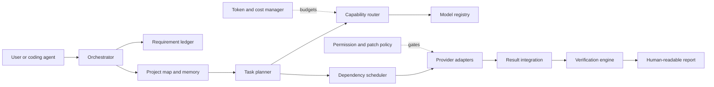

# Architecture

AIFIAR is split into small, replaceable modules.

## Module boundaries
- `core/types.ts`: shared task and result types.
- `requirementLedger.ts`: stable requirement IDs and coverage checks.
- `taskPlanner.ts`: task graph construction and basic classification.
- `taskRouter.ts`: capability-based candidate filtering.
- `dependencyScheduler.ts`: readiness and cycle detection.
- `tokenManager.ts`: usage accounting, not prompt rewriting.
- `projectMemory.ts`: in-process file summaries with freshness metadata.
- `patchPolicy.ts`: protected-path assessment.
- `resultMerger.ts`: evidence aggregation, not majority-vote truth.
- `verificationEngine.ts`: requirement/task status checks.
- `orchestrator.ts`: scheduling loop; does not execute shell commands.

Model output is untrusted input. The host must enforce permissions, validate paths, inspect patches, and isolate execution outside model prompts. Provider adapters, sandboxing, durable storage, and end-to-end tests remain future work.
