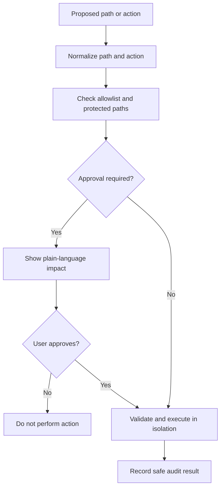

# Permissions and safety

Instructions are not a security boundary. Enforce policy in the host process, filesystem adapter, and execution sandbox.

Default protected areas should include credentials, environment files, authentication, provider/API configuration, billing, deployment, and release settings. Projects can add their own paths.

- Keep secrets outside version control and logs.
- Treat model output, repository files, and web content as untrusted.
- Deny commands and network access by default until allowed by policy.
- Validate paths against traversal and symlink escapes.
- Require explicit authorization for deployment, publishing, destructive changes, and external side effects.
- Never let prompt-injection text bypass host-enforced permissions.
