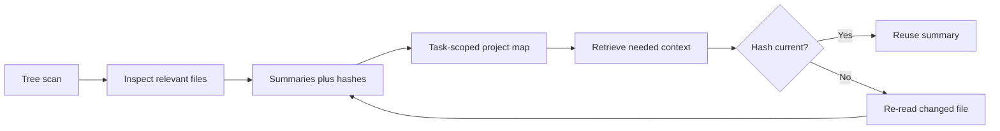

# Project inspection and memory

AIFIAR should map the repository before editing. A file record can include relative path, purpose, key symbols, content hash, last-inspected timestamp, dependencies, related requirement IDs, confidence, and source.

The current `ProjectMemory` helper is in-process only. Durable memory requires a storage backend, freshness invalidation, privacy controls, and user-visible behavior. Do not claim persistent memory across sessions unless implemented. Reuse only current summaries and never omit requirements needed by the subtask.
