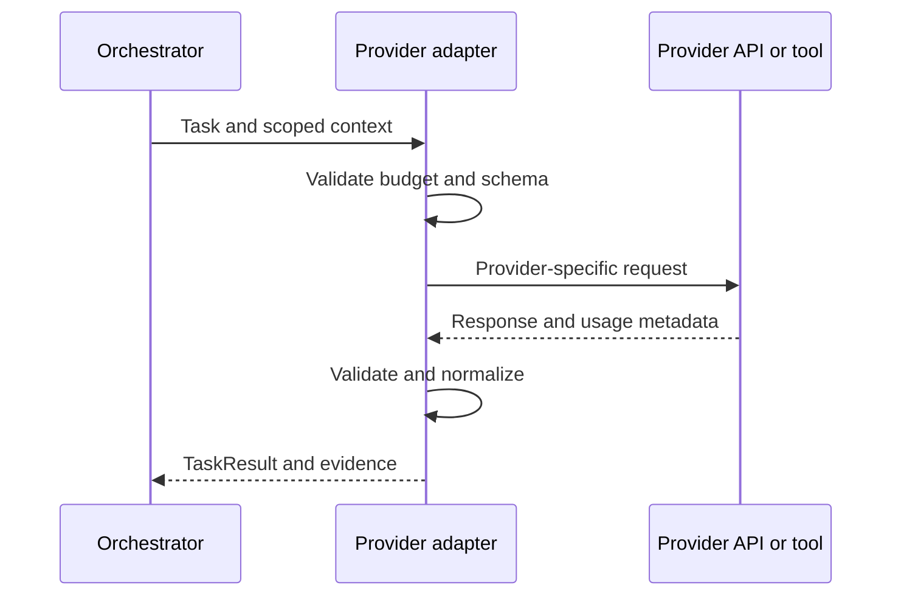

# Provider integration

Each adapter should implement a common contract while keeping provider-specific behavior inside its folder.

1. Confirm current official provider documentation and available access.
2. Declare model IDs and capabilities in the registry.
3. Load credentials from environment variables or a secret manager.
4. Implement timeouts, cancellation, retries, rate-limit handling, and structured errors.
5. Normalize usage metadata and provider responses.
6. Validate structured outputs before accepting results.
7. Add mocked unit tests and opt-in integration tests.
8. Document data handling, retention, and permissions.

GPT and Grok adapters in this scaffold are interface-only placeholders; they do not make network requests. Instructions alone cannot connect an AI tool or grant it filesystem access.
