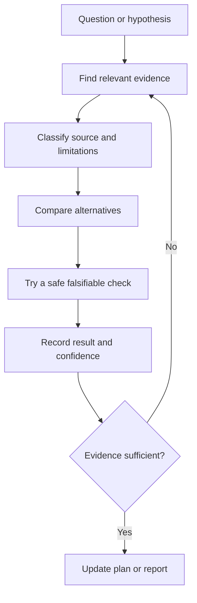

# Reasoning and evidence

AIFIAR should improve reliability by structuring work, testing assumptions, and tracking evidence. It must not treat longer internal reasoning or agreement between models as proof of correctness.

## Evidence loop

## Evidence levels

- Confirmed: direct source, authoritative documentation, or reproducible check supports the claim.
- Likely: multiple useful signals support it, but a decisive check is missing.
- Hypothesis: a testable explanation without enough evidence.
- Unknown: evidence is absent or conflicting.

## Anti-hallucination checks

- Confirm file paths and symbols from the repository.
- Confirm API behavior against current official documentation.
- Record research sources and the exact claims they support.
- Distinguish static analysis from runtime results.
- Check alternative explanations before declaring a root cause.
- Use a small experiment to disprove assumptions where safe.
- Never treat model consensus as a substitute for tests or source evidence.
- Preserve unresolved uncertainty in the final report.

## Capability-based routing

Candidate ranking may use declared task support, required tools, context fit, measured task quality, latency, and cost. A ranking is a recommendation, not proof that a model will succeed. Evaluation data should be recent and specific to the task type.
