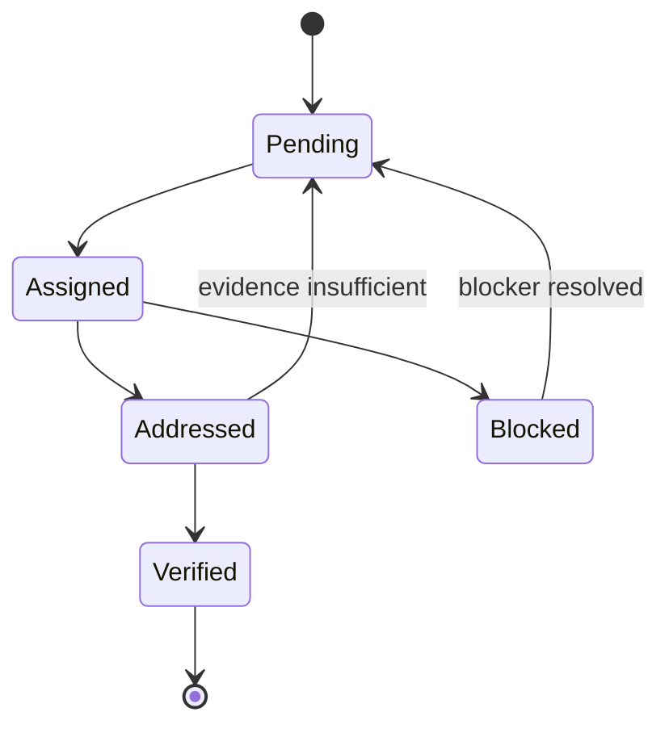

# Requirement preservation

AIFIAR must not perform lossy prompt compression. It may organize work into structured tasks, but every explicit requirement and constraint must remain traceable.

Rules:
1. Keep the original request available to the coordinator.
2. Create stable IDs such as `R001`.
3. Preserve constraints, exclusions, output format, and permission boundaries.
4. Link each task to requirement IDs and supply the actual relevant text.
5. Never mark a requirement verified just because a model claims it is done.
6. Require appropriate evidence such as diffs, test results, or documented findings.
7. Ask about conflicting requirements rather than silently choosing.
8. If context limits prevent complete processing, pause and explain instead of dropping details.
