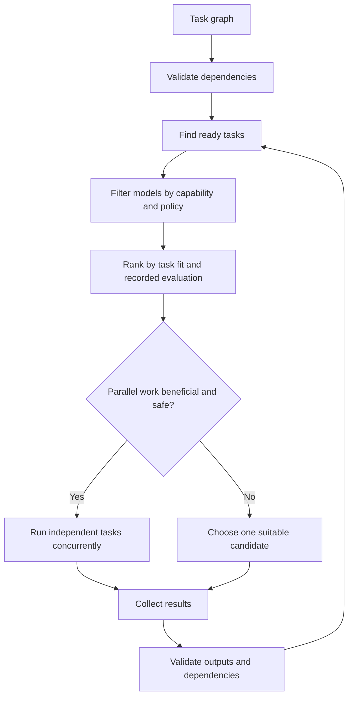

# Routing and parallelism

Routing signals include task kind, tool access, estimated context needs, provider availability, explicit provider allow/deny lists, and optional task-specific evaluation observations. The router uses `rankCandidates` and accepts host-supplied quality, latency, and cost observations through `routingEvaluations`. The orchestrator can receive those evaluations and per-task input-token estimates. Estimates are not measurements; model quality values must come from recorded, task-relevant evaluation results.

The ranking is a heuristic, not a learned policy or a guarantee of quality. Exact task-kind fit, declared structured-output/tool support, observed task quality, latency, and cost influence the score. Candidates missing required tools, unavailable providers, or known-insufficient context are excluded. Unknown context-window metadata is not enough to guarantee a fit; this generic router leaves such candidates eligible, so the host must validate actual request size before dispatch.

For defensible routing evaluation, use the same versioned benchmark cases and independent verifier across single-model and multi-model runs. See [evaluation and cache](evaluation-and-cache.md) for the benchmark report and comparison APIs. Do not fill missing token/cost fields with invented values.

Do not let multiple agents edit the same shared working tree concurrently. Prefer isolated worktrees or patch proposals. Parallelism can reduce latency but can increase total tokens and cost. Model consensus is not a substitute for source evidence or tests.
