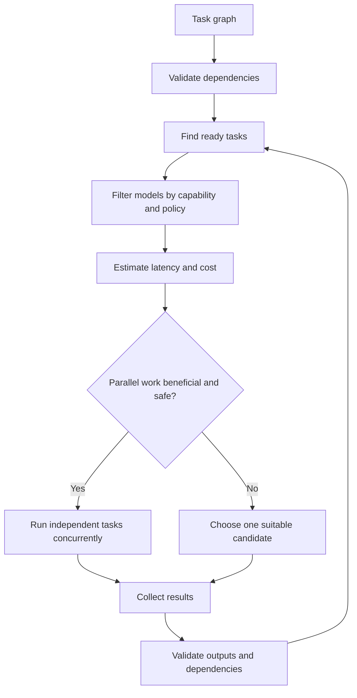

# Routing and parallelism

Routing signals include task kind, tool access, context needs, provider availability, rate limits, budget, privacy rules, and evaluated performance on similar tasks. Do not assume a model is best because of its brand or name.

Do not let multiple agents edit the same shared working tree concurrently. Prefer isolated worktrees or patch proposals. Parallelism can reduce latency but can increase total tokens and cost. Model consensus is not a substitute for source evidence or tests.
