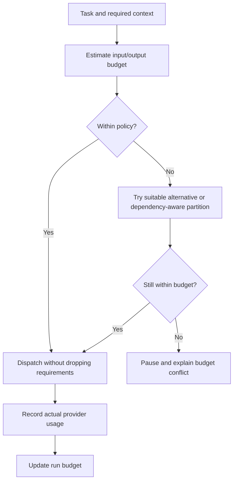

# Token and cost management

AIFIAR's default policy is budget management, not lossy prompt compression.

Track provider-reported input/output tokens, estimated cost with a pricing version, per-task/run budgets, and reserve for verification. Reuse verified file summaries only while their hashes are current. Avoid duplicate requests. Choose a cheaper model only when its capability and quality fit the task.

Do not promise that a 20,000-token task can always be reduced to 2,000 tokens without loss. If necessary context cannot fit, partition the work with requirement traceability or ask the user to authorize a trade-off. Never silently drop details.
