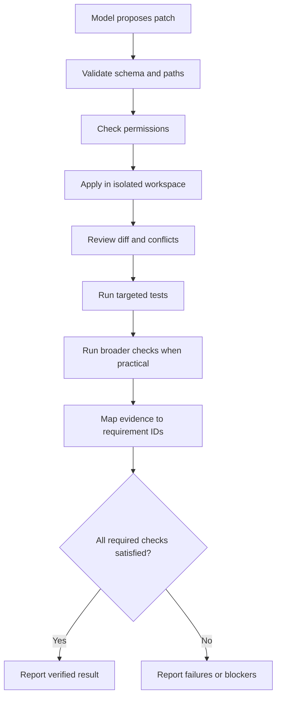

# Patch integration and verification

Use deterministic tests and static checks where possible. Compare behavior before/after for risky changes. Generated tests are useful but not automatically sufficient. Validate against the original requirements, not just a model's summary. Preserve failure output and explain environment limitations. Never report success based only on a plausible diff.
