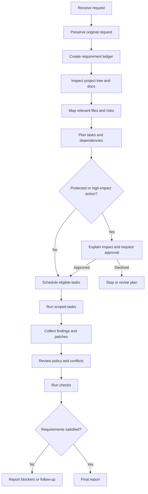

# End-to-end workflow



The final report should state the outcome, files changed, requirements addressed or blocked, checks actually run, risks, and unverified items. A report must never claim success without evidence.


## Executable repository workflow

The `runRepositoryWorkflow` helper in `core/repositoryWorkflow.ts` connects repository scanning, persistent memory, symbol indexing, task-scoped context assembly, model routing, and task execution.

```ts
import { runRepositoryWorkflow } from "./core/repositoryWorkflow.js";
import { createProviderRuntime } from "./models/providerRuntime.js";

const runtime = createProviderRuntime();
const report = await runRepositoryWorkflow(
  workPlan,
  runtime.registry,
  runtime.executor,
  {
    repositoryId: "owner/repository",
    rootPath: process.cwd(),
    storeDirectory: "./.aifiar/memory",
    commit: process.env.GIT_COMMIT
  }
);

console.log(report.context.warnings);
console.log(report.orchestration.results);
```

Supply a real, validated `WorkPlan` as `workPlan`. This helper performs analysis-task orchestration only. It does not apply model-proposed edits or run arbitrary repository commands. Changes still need the patch policy, exact-digest approval, freshness checks, safe patch transaction, and multi-stage verification before they can be accepted.

Context is selected per task and bounded by file count, per-file size, and total size. It includes source hashes as references and redacts common secret patterns. The repository scanner never follows symlinks. If a scan is incomplete, the report includes a warning and the partial snapshot is not persisted.
