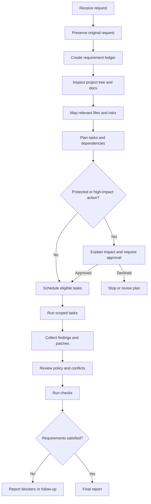

# End-to-end workflow

The final report should state the outcome, files changed, requirements addressed or blocked, checks actually run, risks, and unverified items. A report must never claim success without evidence.
